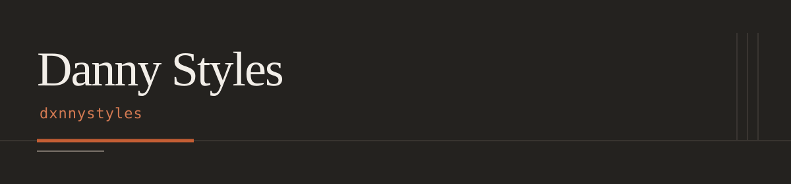

## 01 · Identity

Danny Styles · `dxnnystyles`

## 02 · About

I’m Danny Styles, known here as `@dxnnystyles`.

## 03 · Currently

Building a standalone, same-device chess experience for the browser.

## 04 · Selected work

- [Browser Chess](https://github.com/dxnnystyles/browser-chess) — a local, two-player chess project for the browser; in development.

## 05 · GitHub activity

GitHub’s native contribution activity on this profile belongs to `dxnnystyles`.

## 06 · Featured project: slappywax

## 07 · Chess

[Follow Browser Chess](https://github.com/dxnnystyles/browser-chess) as the standalone game takes shape.

## 08 · Beyond code

## 09 · Contact / links

[GitHub · @dxnnystyles](https://github.com/dxnnystyles)
