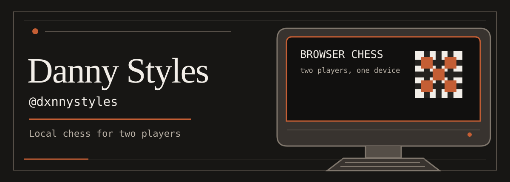
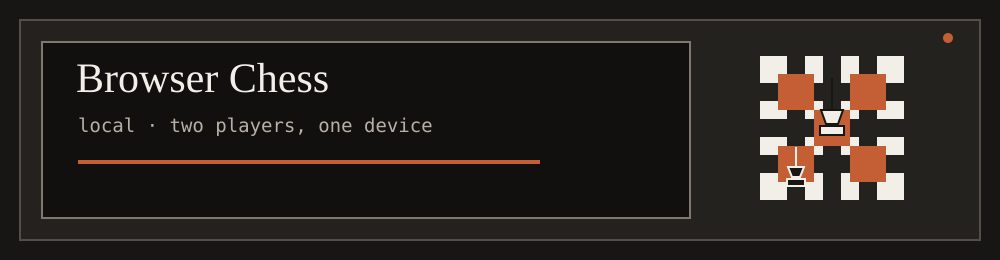

## Danny Styles

`@dxnnystyles`

A local chess game for two players on one device.

## About

I’m Danny Styles, known on GitHub as `@dxnnystyles`. I build software for the browser; Browser Chess is the featured project here.

## Currently

> **Browser Chess is live.** A local game for two players on one device.

## Selected work

### Browser Chess

A standalone chess game that runs locally in the browser.

[Source code](https://github.com/dxnnystyles/browser-chess)

## GitHub activity

GitHub generates the contribution activity on my profile for `@dxnnystyles`.

## Featured project: slappywax

[Danny Styles - slappywax](https://open.spotify.com/album/0aLqVmlz4ytvJRcGKW8q4D)

## Chess

**[Play Browser Chess](https://dxnnystyles.github.io/browser-chess/)**

## Beyond code

Music: [slappywax](#featured-project-slappywax)

## Contact / links

[GitHub profile for @dxnnystyles](https://github.com/dxnnystyles)
