<h1 align="center">dxnnystyles</h1>

Software · Chess · Music

<h2 align="center">Apps &amp; Scripting</h2>

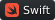  

<h2 align="center">Web</h2>

Languages 
 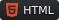   
Runtime &amp; Tooling 
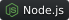  
Frameworks 
   
Platform 
 
🇺🇸 English &nbsp; · &nbsp; 🇫🇷 Français · Learning

<h2 align="center">GitHub Activity</h2>
<!-- profile-snapshot-date: 2026-10-28 -->

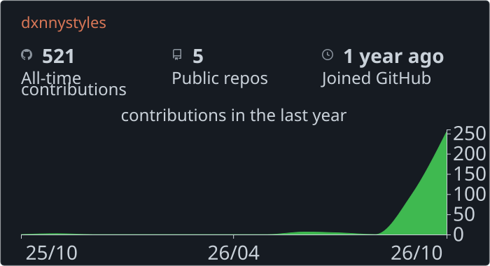


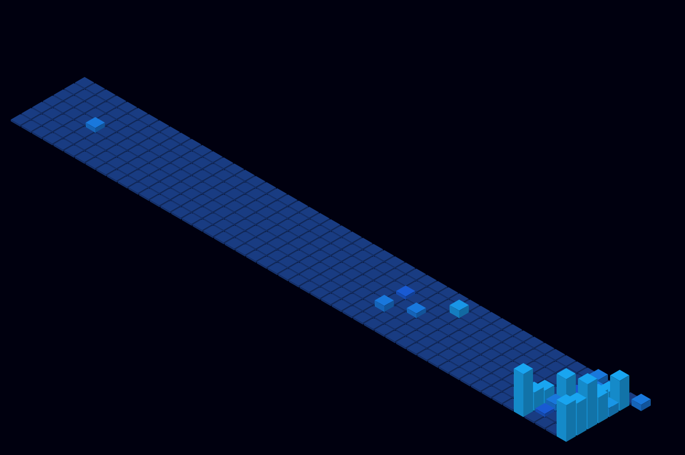

<h2 align="center">Stats</h2>

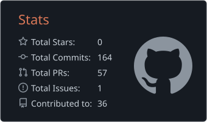 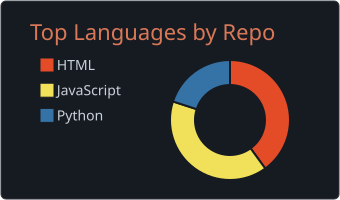

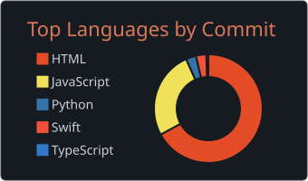 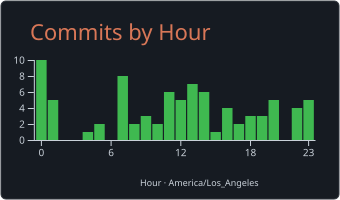

<h2 align="center">Projects</h2>

<a href="https://dxnnystyles.github.io/browser-chess/">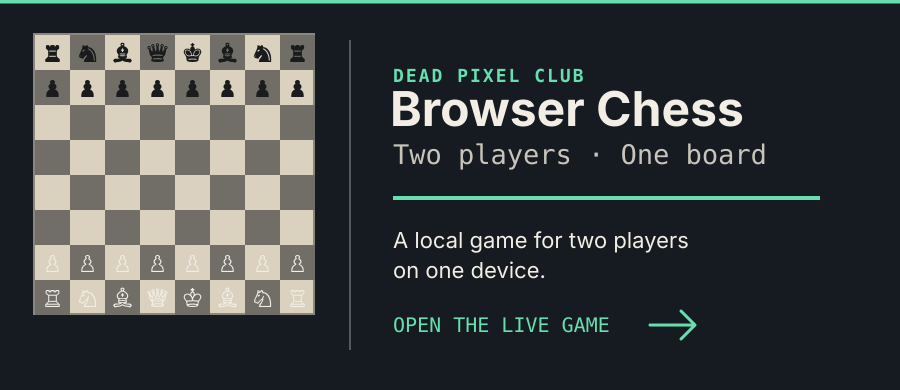</a> <a href="https://github.com/dxnnystyles/browser-chess">Browser Chess Source</a>

<h2 align="center">Music / Other</h2>

<a href="https://open.spotify.com/album/0aLqVmlz4ytvJRcGKW8q4D">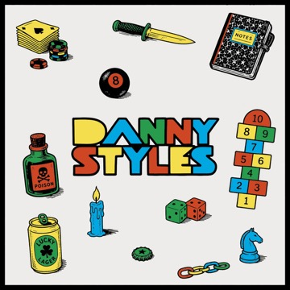 Danny Styles - slappywax</a>

