<h1 align="center">dxnnystyles</h1>

Software · Chess · Music

<strong>Stack</strong>

  Apps &amp; tools 
   &nbsp;
   &nbsp;
   
  Web 
   &nbsp;
   &nbsp;
   
  Browser Chess 
   &nbsp;
  

  

  

  <a href="https://github.com/dxnnystyles/browser-chess">Source</a>

  

<a href="https://open.spotify.com/album/0aLqVmlz4ytvJRcGKW8q4D">Danny Styles - slappywax</a>

