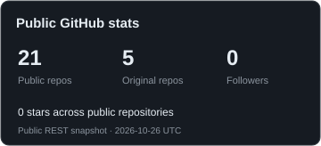
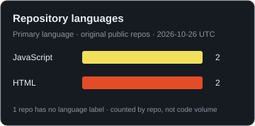
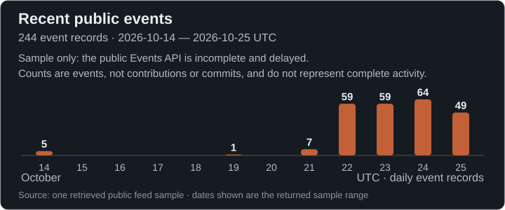

<strong>dxnnystyles</strong> Software · Chess · Music

<strong>Apps &amp; Scripting</strong> 
  

<strong>Web</strong> 
Languages 
    
Runtime &amp; Tooling 
  
Frameworks 
   
Platform 
 
🇺🇸 English &nbsp; · &nbsp; 🇫🇷 Français · Learning

<strong>GitHub activity</strong> 

<strong>3D Night View · public contribution calendar</strong> 

<strong>GitHub Stats · Repository Languages</strong> 
 

<strong>Recent Public Events</strong> 

 <a href="https://github.com/dxnnystyles/browser-chess">Browser Chess Source</a>

<a href="https://open.spotify.com/album/0aLqVmlz4ytvJRcGKW8q4D"> Danny Styles - slappywax</a>

